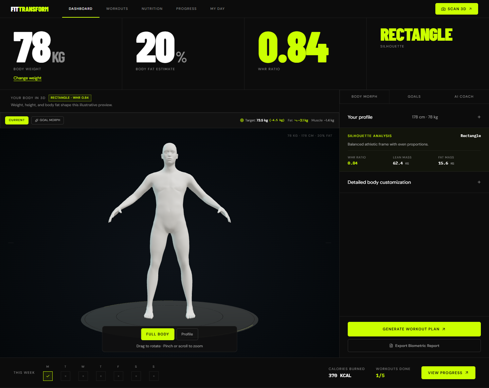
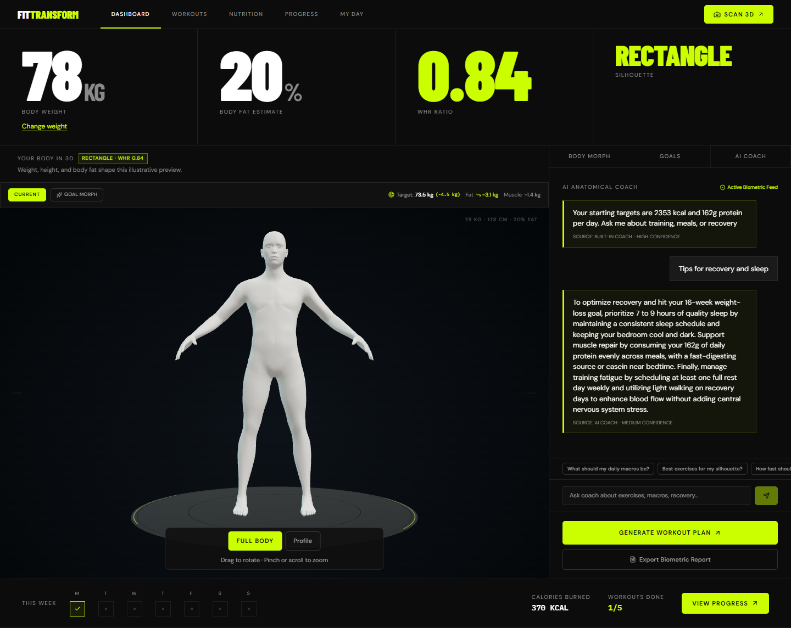
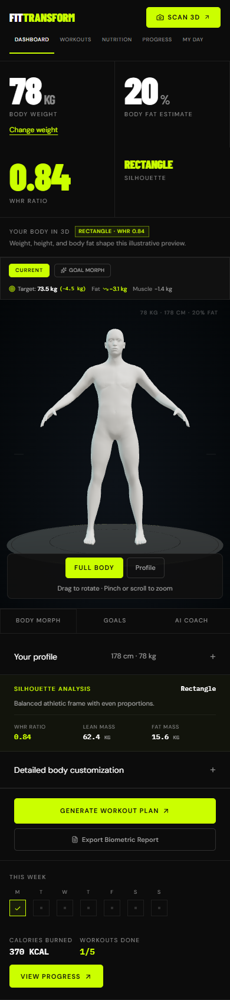
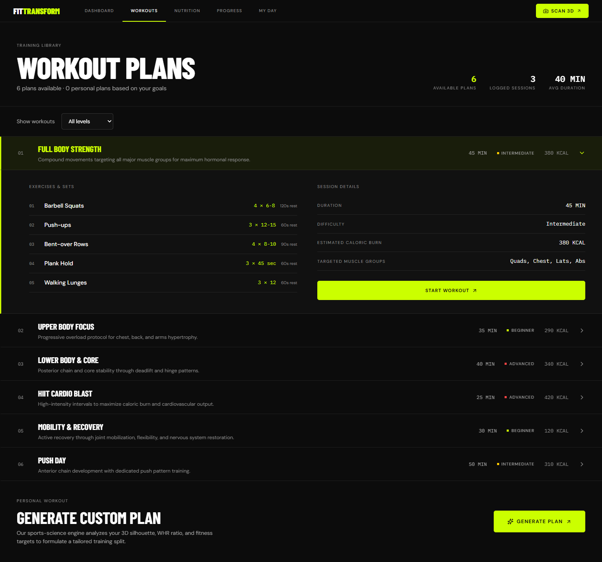
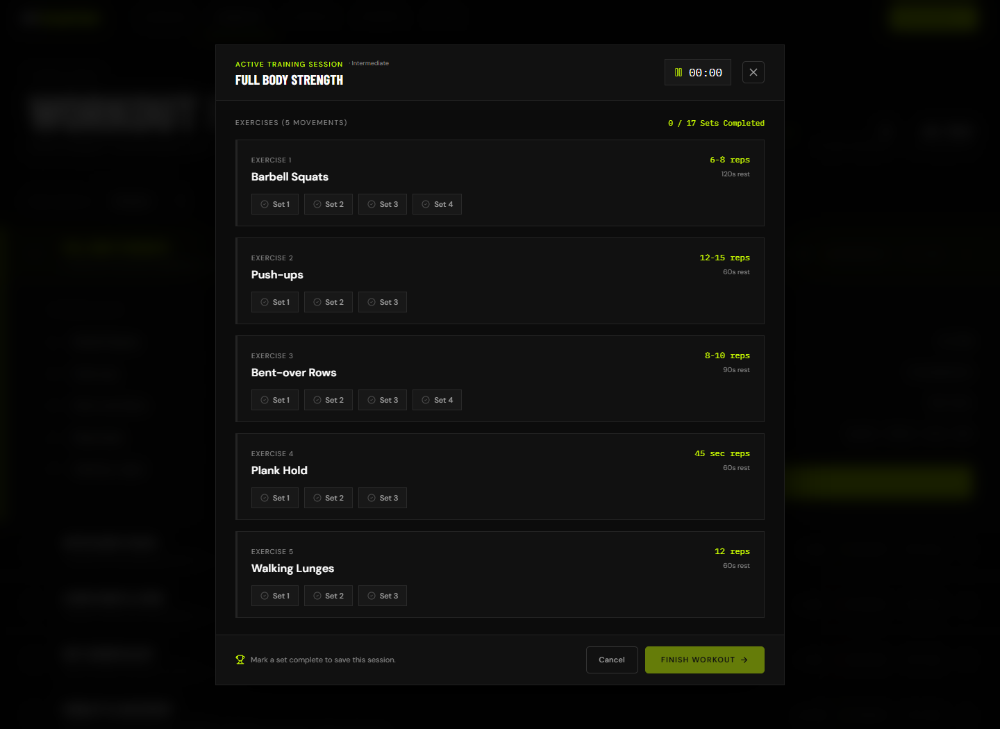
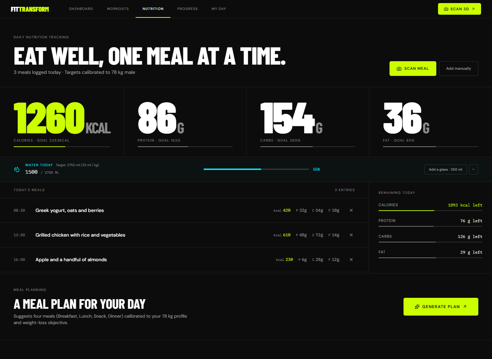
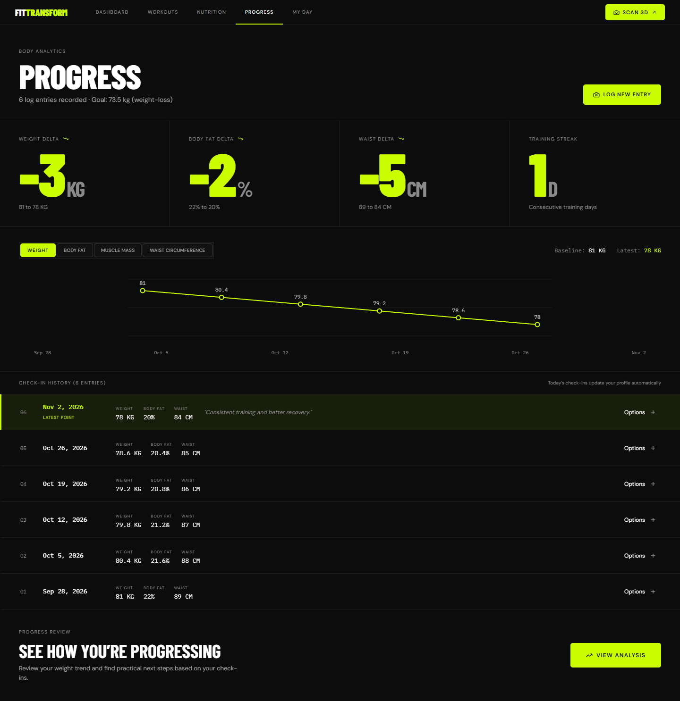
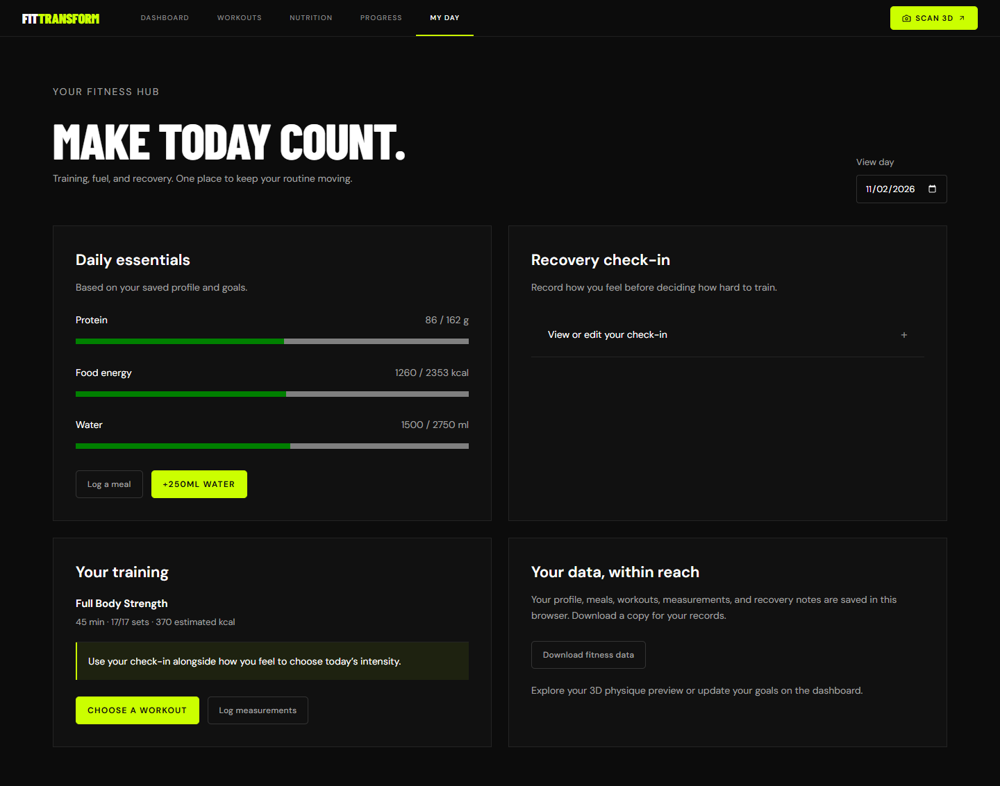

# FitTransform

A fitness hub that connects an interactive 3D physique preview with workouts, food logging, recovery, and progress tracking. Built with Next.js, React, Three.js, and Gemini AI.

The interface keeps everyday actions visible and puts detailed measurements behind optional sections. The visual identity uses a dark background, lime accents, condensed headings, and a matching FT favicon.

## Page guide

- [Dashboard and 3D body preview](#dashboard-and-3d-body-preview)
- [Workouts](#workouts)
- [Nutrition](#nutrition)
- [Progress](#progress)
- [My day](#my-day)
- [Run the same experience](#run-the-same-experience)

**Screenshot note:** All screenshots below are actual captures of the application using an isolated browser and illustrative sample records. They contain no private account data or API keys. New visitors start with their own empty logs; the documentation records are never injected into normal visits.

## Dashboard and 3D body preview

Route: `/`



- **Current body metrics:** current weight, estimated body-fat percentage, waist-to-hip ratio, and an approximate silhouette classification.
- **Change weight:** open the link beneath Body Weight, enter kilograms, and save. The profile, 3D shape, and daily targets update together. This edits the current profile; Progress records dated check-ins.
- **Mass-driven 3D preview:** kilograms affect whole-body volume rather than only a few girth sliders. Height, estimated body fat, and optional proportions affect the resulting shape. Male and female models are supported; new profiles default to male.
- **Touch and mouse navigation:** drag to rotate, pinch or scroll to zoom, and use Full body or Profile to reframe the camera. The viewer refits to phone and desktop dimensions.
- **Current and goal comparison:** switch to Goal Morph to preview the target weight and composition. The ribbon summarizes estimated changes in weight, lean mass, and fat mass.
- **Your profile:** edit model sex, age, height, and estimated body fat. Smart Sync regenerates starting proportions from the profile.
- **Detailed body customization:** optional body-type presets and individual proportion controls for the torso, shoulders, arms, waist, hips, and legs. Reset restores profile-derived proportions.
- **Goals:** select weight loss, muscle gain, body recomposition, or strength. Set target weight and timeline, then inspect the derived calorie target, weekly change, waist-to-hip estimate, and goal progress. Newly generated plans use this goal.
- **AI coach:** ask questions about training, meals, and recovery or use a suggested prompt. Replies indicate whether they came from Gemini or the built-in fallback.
- **Scan 3D:** the shared navigation shortcut opens the body-photo tool. Upload a photo, adjust contour calipers, use the reference silhouette, request AI estimates, and review proportions before applying them to the avatar.
- **Biometric report:** inspect the current profile, derived metrics, goal, and nutrition targets; print the report or download its JSON representation.
- **Weekly activity:** view completed training days, the current week’s estimated workout calories, and session count, with a shortcut to Progress.

<details>
<summary>AI coach inside the dashboard</summary>



</details>

<details>
<summary>Mobile dashboard</summary>



</details>

## Workouts

Route: `/workouts`



- **Training library:** browse curated strength, upper-body, lower-body, cardio, mobility, and push routines.
- **Filters:** select all levels, Beginner, Intermediate, Advanced, or My plans.
- **Routine details:** expand a workout to inspect exercises, sets, repetitions, rest periods, difficulty, duration, muscle groups, and estimated calorie burn.
- **Personal workout generation:** create a routine from the current profile and goal. Gemini-generated plans and built-in fallback plans are identified in the interface and saved locally under My plans.
- **Guided sessions:** start a routine, track elapsed time, pause or resume, and mark each set complete.
- **Rest timer:** completing a set starts its rest countdown; add 30 seconds or skip the remaining rest.
- **Save a workout:** finishing records elapsed time, completed and total sets, muscle groups, and estimated calories. At least one set is required. Cancel exits without creating a completed-session record.
- **Training summaries:** completed sessions update the library totals, average logged duration, dashboard activity, progress streak, and My day. A completion banner summarizes the session and links back to the dashboard.

<details>
<summary>Guided workout session</summary>



</details>

## Nutrition

Route: `/nutrition`



- **Daily nutrition totals:** track calories, protein, carbohydrates, and fat against profile- and goal-derived targets, with remaining amounts and progress bars.
- **Manual food logging:** enter a meal name and calories. Protein, carbs, and fat are optional. Calories-only entries are labelled so incomplete macro totals are clear.
- **Meal history:** each entry shows its time and supplied nutrition values; remove an entry to correct the daily totals.
- **Photo meal scanner:** upload or photograph a JPEG, PNG, or WEBP meal image. Review recognized foods, estimated portions, nutrients, confidence, and any caveat before logging.
- **Selection before logging:** include or exclude individual recognized foods, inspect the selected totals, then add only those foods to the day’s log.
- **Scan recovery:** replace a photo, cancel a scan, discard results, or switch to manual logging if recognition is unavailable. No food is invented by the offline fallback.
- **Hydration:** add a 250 ml glass or remove 250 ml to correct the log. The suggested target follows the profile weight.
- **Meal planning:** generate four suggested meals with descriptions and nutrition estimates. Plans are checked against the requested calorie target; the interface labels AI and fallback output.
- **Log a plan:** add the generated meals to today’s record. A plan can be logged once per generation to prevent accidental duplicate logging.

## Progress

Route: `/progress`



- **Weight-first check-ins:** save a date and weight, with optional body fat, muscle percentage, waist circumference, and notes.
- **Automatic current-profile sync:** today’s check-in updates the current profile and regenerates the 3D preview. Historical entries remain in the timeline without automatically replacing today’s profile.
- **Metric charts:** switch among weight, body fat, muscle mass, and waist circumference. Missing optional measurements are omitted from their charts rather than plotted as zero.
- **Change summaries:** compare the first and latest available measurements and see the training streak derived from completed workouts.
- **Check-in history:** review entries in date order, identify the latest point, and inspect recorded notes and measurements.
- **Entry options:** explicitly sync an older measurement to the avatar or delete an incorrect entry.
- **Progress analysis:** request a trend summary and practical suggestions. Weight velocity and the projected goal date use the recorded series; Gemini adds commentary when available. The built-in analysis remains available offline.

## My day

Route: `/today`



- **Day selection:** inspect today or a prior date without altering its records.
- **Daily essentials:** see food energy, protein, and water for the selected day alongside current targets; jump to Nutrition to log food.
- **Quick water logging:** add a 250 ml glass for today. This action is disabled when viewing a historical date.
- **Recovery check-in:** expand the optional form to record sleep, steps, energy, muscle soreness, and notes. Saved entries can be reviewed and edited for that day.
- **Recovery context:** low reported energy or high soreness produces a suggestion to consider an easier session or recovery day.
- **Training overview:** view sessions completed on the selected date, including duration, set completion, and estimated calories.
- **Useful shortcuts:** choose a workout, record measurements, or return to the 3D preview.
- **Download fitness data:** export the current profile, goals, meals, water, workouts, measurements, custom plans, and recovery notes as JSON. This is a backup/export feature; there is no import interface or account sync.

## Run the same experience

### Requirements and installation

Use Node.js 20.9 or newer and a current WebGL-capable browser. Chrome/Edge are useful for reproducing the documentation screenshots. The 3D viewer has a WebGL-unavailable message; the tracking pages remain usable.

```sh
npm ci
npm run dev
```

Development normally serves at `http://localhost:3000`. The scripts explicitly use Webpack, the build engine verified for this repository.

For the same production preview used in this session:

```sh
npm run build
npm run preview
```

Open `http://localhost:3006`. `npm start` is also available for hosts that supply their own `PORT` environment variable.

### AI configuration

1. Create a Gemini key in [Google AI Studio](https://aistudio.google.com/app/apikey), using a free-tier project if free usage is required.
2. If `.env.local` does not exist, copy `.env.local.example` to it. Preserve an existing configuration and key.
3. Set `GEMINI_API_KEY` and leave `GEMINI_MODEL=gemini-3.5-flash-lite` unless a different supported model is desired.
4. Restart the Next.js server after changing the environment.

The same server-side key serves workout planning, meal planning, coaching, progress analysis, meal-photo recognition, and body-photo estimates for every visitor to that deployment. Visitors do not need to enter their own key. The key stays in the server environment and must never be committed, placed in README examples, or exposed through a `NEXT_PUBLIC_` variable.

Free-tier eligibility and shared quotas are controlled by Google. Text features have labelled built-in fallbacks when the service is missing or unavailable. Photo recognition needs live AI; its fallback state is explicitly identified. Free-tier model pricing and availability can change: consult [Google’s pricing documentation](https://ai.google.dev/gemini-api/docs/pricing).

### What visitors share, and what stays personal

- **Shared experience:** the application, fonts served by Next.js, bundled body-model assets, navigation, favicon, responsive layouts, calculations, and server-side AI integration.
- **Independent records:** each browser/origin stores its own profile and logs. A fresh visitor starts with the default male profile and empty tracking records. Existing saved choices are preserved.
- **No shared personal data:** documentation demo records are restricted to the capture script’s isolated browser. They are not production defaults.
- **Persistence:** records survive reloads and synchronize between tabs on the same browser/origin. They do not automatically follow a person to another device, browser, hostname, or port.
- **Server dependency:** AI needs the Next.js backend and its configured environment. A static-only upload of the frontend does not provide the AI endpoints.

To share the running site on the same network, use the server’s printed Network URL, not another person’s `localhost`. The host must be running and reachable through its firewall. A public internet URL requires deploying this Node/Next.js app and setting the private Gemini environment variables on that host. This repository does not yet provide accounts, cloud data sync, or a public deployment.

## 3D model behavior and limits

The renderer blends lean/fat and measurement shapes, adds a corrective abdominal distribution shape, and calibrates relative mesh volume to mass at the requested height. Corrections use the skeleton’s bind-pose axes to retain limb lengths, and the final mesh is grounded and normalized to stature. Current and goal previews use their respective weights; changes above 150 kg remain visible.

The avatar is illustrative. Kilograms alone do not determine a person’s proportions, body composition, or health. Updating weight preserves the current body-fat estimate, which can be changed under Your profile. Body-photo measurements, food portions, nutrition figures, calorie burn, and goal projections are estimates for the user to review.

Reference techniques: [Unreal Engine morph targets](https://dev.epicgames.com/documentation/unreal-engine/fbx-morph-target-pipeline?application_version=4.27) and [MakeHuman target blending](https://github.com/makehumancommunity/mpfb2/blob/master/docs/services/targetservice.md).

## Icons and screenshots

- `app/icon.svg`: scalable FT monogram in the site’s black-and-lime palette.
- `app/favicon.ico`: 16, 32, and 48 px favicon variants.
- `app/apple-icon.png`: 180 px Apple home-screen icon.
- `docs/screenshots/`: full-page desktop captures, feature views, and a mobile dashboard.

Regenerate screenshots against a running server:

```sh
node scripts/capture-readme.mjs
```

The script uses an isolated Chrome/Chromium profile and sample records, waits for fonts and the model, and captures every page. Set `PUPPETEER_EXECUTABLE_PATH` if Chrome is not in a standard location, and `README_CAPTURE_URL` if the site runs at a different URL. The coach screenshot makes one AI request; it shows a labelled fallback if live AI is unavailable. Normal visitors are never seeded with these records.

## Verification

```sh
npm test
npx tsc --noEmit
npm run build
```

Tests cover calculations, goal-specific plans, persistence validation, limb scaling, chest morphs, camera framing, request limits, and success/fallback paths for the AI routes. Actual male and female GLB assets are used to check mass-volume ratios over 40–250 kg, height preservation, and composition differences. Mocked AI tests establish response handling; they do not establish the accuracy of a photo estimate. The configured local deployment has also been exercised with live Gemini requests across all six AI features.
